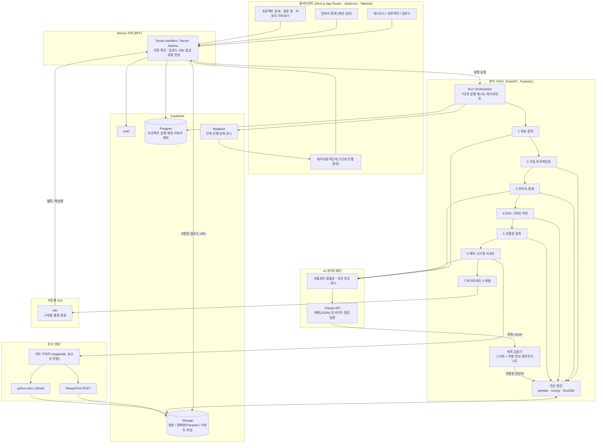
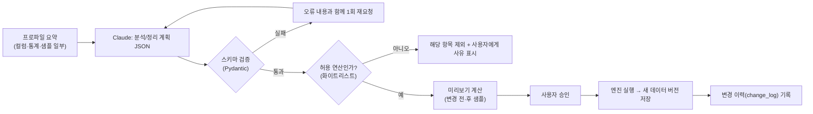
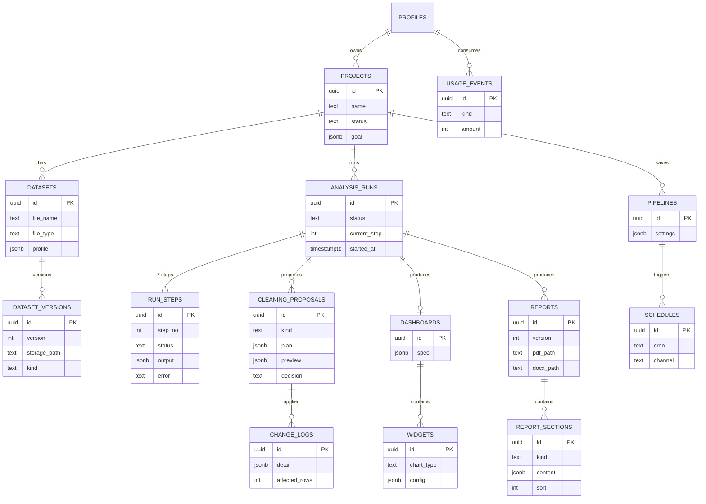
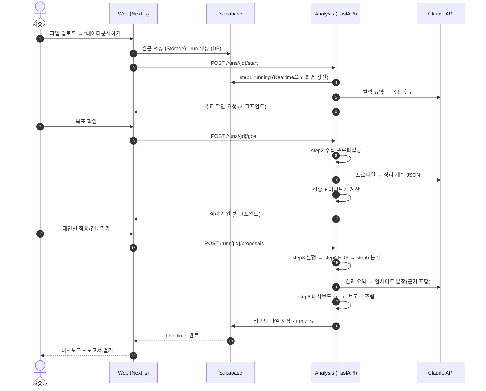
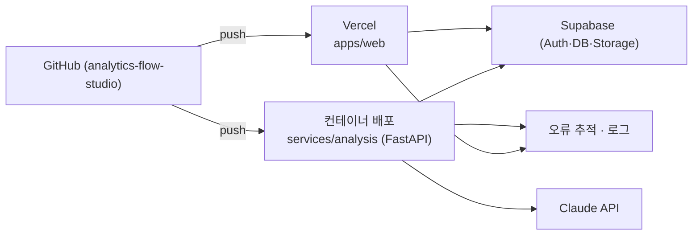

# 02. 시스템 구조도 (Architecture)

> 원칙: **AI는 계획만 세우고, 서버가 검증한 연산만 실행한다.** 원본은 바꾸지 않고 버전으로 쌓는다. 진행 상황은 실시간으로 화면에 보여준다.

## 1. 전체 구조

### 구성요소 역할

| 구성요소 | 역할 | 선택 이유 |
|---|---|---|
| Next.js (App Router) | 화면, 인증 세션, BFF | 기존 스택과 동일, 서버 컴포넌트로 초기 로딩 단축 |
| shadcn/ui + Tailwind | 디자인 시스템(시안과 동일 토큰) | 빠른 UI, 접근성 기본 제공 |
| FastAPI + Pydantic | 분석 API, 계획 검증 | pandas·DuckDB 생태계, 타입 검증 |
| pandas / numpy | 전처리·통계 | 표준 |
| DuckDB | 큰 CSV를 SQL로 집계 | 파일 기반이라 서버 구성이 단순 |
| Supabase | 인증·DB·파일·실시간 | 1인 운영에 적합, RLS로 데이터 격리 |
| Claude API | 정리 제안·인사이트·질문 답변 | JSON 출력 + 긴 문맥 |
| WeasyPrint / python-docx | PDF·Word | 기존 출판 파이프라인 경험 재사용 |
| n8n | 스케줄·알림(7단계) | 코드 없이 자동화, v2 |

## 2. AI 계획 → 검증 → 실행 구조 (핵심 안전장치)

- **허용 연산 예시**: 날짜 형식 변환, 문자열 정규화(대소문자·공백), 중복 제거, 결측 채움(0/평균/중앙값/제외), 타입 변환, 이상치 표시/제외, 컬럼 이름 변경.
- **금지**: 임의 코드 실행, 외부 네트워크 호출, 파일 시스템 접근.
- AI에 보내는 데이터는 **요약 통계와 소수의 샘플 행**으로 제한합니다(전체 원본 전송 금지, 개인정보 컬럼은 마스킹 옵션).

## 3. 데이터 모델 (ER)

핵심 규칙
- 모든 테이블에 `owner_id`(또는 프로젝트 경유) 기준 **RLS(행 수준 보안)** 적용.
- `dataset_versions.kind`: `raw`(원본) / `cleaned`(정제) — **원본은 수정 불가**, 정제는 새 버전.
- `run_steps.output`에 단계 산출물(JSON)을 저장하고 보고서는 이 값을 조립해서 만듭니다.
- `cleaning_proposals.decision`: `pending / applied / skipped`.

## 4. 실행·실시간 진행 구조

- 단계 상태는 `pending → running → waiting_user → done / failed` 로 관리하며, 화면의 7단계 진행 애니메이션이 이 값을 그대로 표시합니다.
- 실패 시 해당 단계부터 **재시도**할 수 있고, 이전 단계 산출물은 재사용합니다.

## 5. 배포 구조

| 환경 | 용도 | 비고 |
|---|---|---|
| local | 개발 | Supabase CLI, 로컬 FastAPI |
| preview | PR 확인 | Vercel Preview + 테스트용 Supabase 브랜치 |
| production | 서비스 | 비밀키는 환경변수, 서비스 키는 서버에만 |

## 6. 보안·운영 기준

| 항목 | 기준 |
|---|---|
| 데이터 격리 | RLS 필수, 스토리지 경로에 사용자 ID 포함, 서명 URL 만료 짧게 |
| 업로드 | 형식 CSV·XLSX, 파일당 50MB(초기), 확장자·MIME·내용 검사, 매크로(xlsm) 거부 |
| AI 전송 | 요약·샘플만, 개인정보 컬럼 마스킹 옵션, 프롬프트·응답 로그에서 원본 값 제외 |
| 실행 안전 | 허용 연산만, 시간·메모리 제한, 실행 단위 타임아웃 |
| 비용 통제 | 사용자별 AI 호출 한도, 같은 프로파일 결과 캐시 |
| 백업·삭제 | 프로젝트 삭제 시 파일·버전 즉시 삭제 옵션, 정기 DB 백업 |
| 관측 | 단계별 소요시간·실패율·AI 토큰 사용량 기록 |
