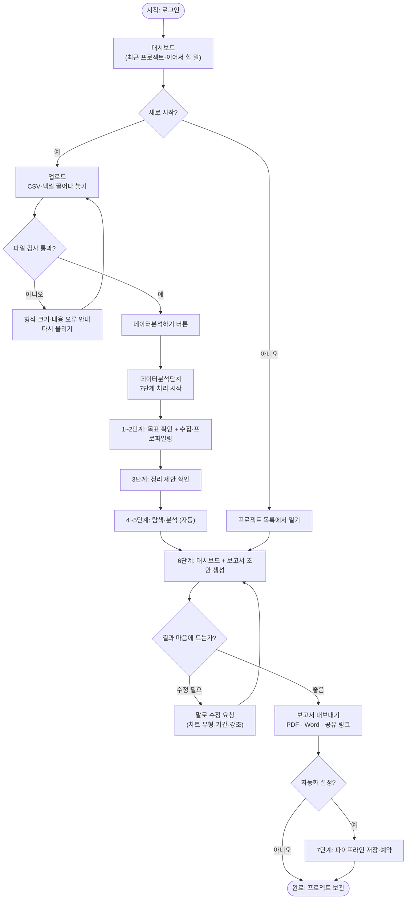
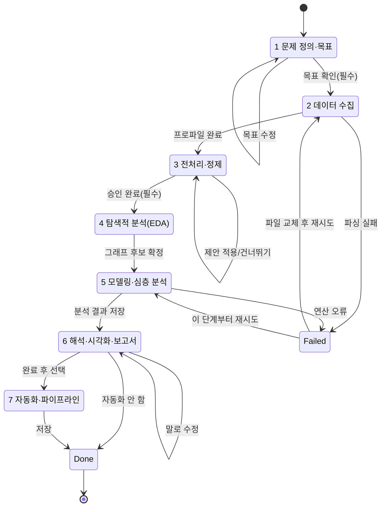
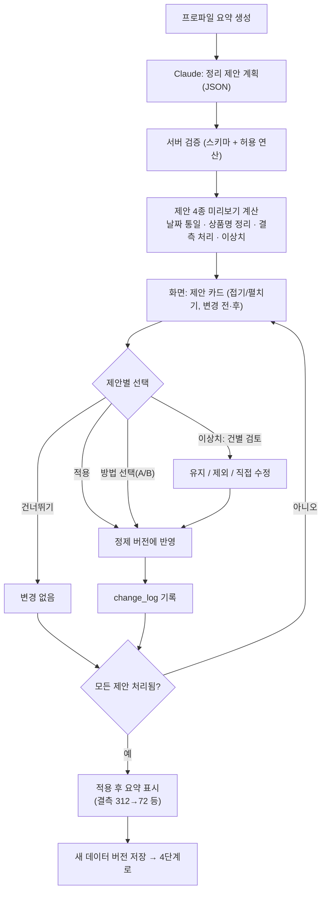
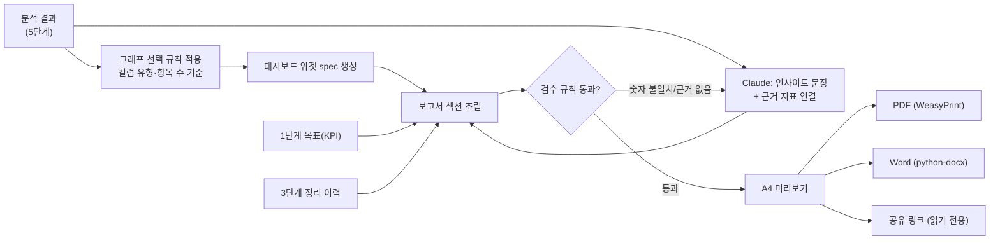
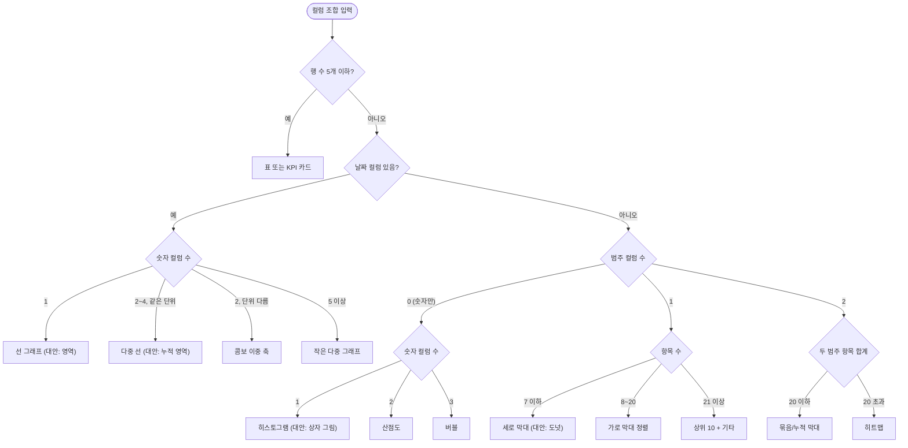
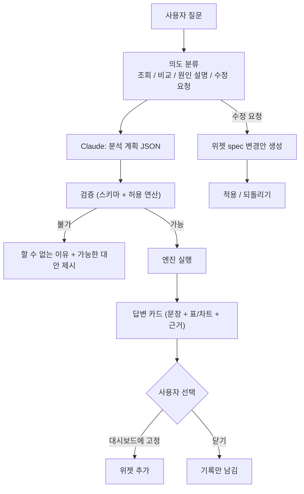
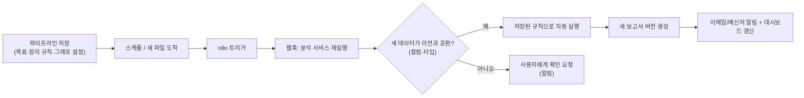

# 03. 플로차트 (Flowcharts)

> 기준 흐름: **파일 업로드 → 데이터분석처리단계(7단계) → 보고서 작성**

## 1. 전체 사용자 흐름

## 2. 7단계 데이터분석처리 — 상태 흐름

단계 상태값: `pending → running → waiting_user → done / failed` (화면의 진행바·애니메이션이 이 값을 그대로 표시)

## 3. 3단계 전처리·정제 — 제안 승인 흐름

## 4. 6단계 보고서 작성 흐름

검수 규칙 (자동)
1. 문장에 쓰인 숫자는 원본 계산 결과와 일치해야 함(불일치 시 재작성)
2. 모든 인사이트는 근거 위젯 1개 이상과 연결
3. 정리 이력이 있으면 부록에 반드시 포함
4. 샘플·가정 값은 "예시"로 표시

## 5. 그래프 선택 의사결정 흐름

추가 규칙: 목표값이 있으면 불릿, 음수가 있으면 도넛 제외, 단위가 섞이면 이중 축 또는 분리, 결측 구간은 선을 끊고 점선 표기.

## 6. 질문 창(자연어) 처리 흐름

## 7. 자동화(7단계) 흐름 — v2

